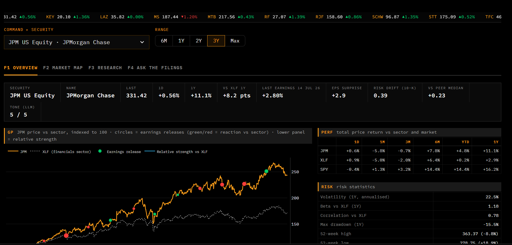
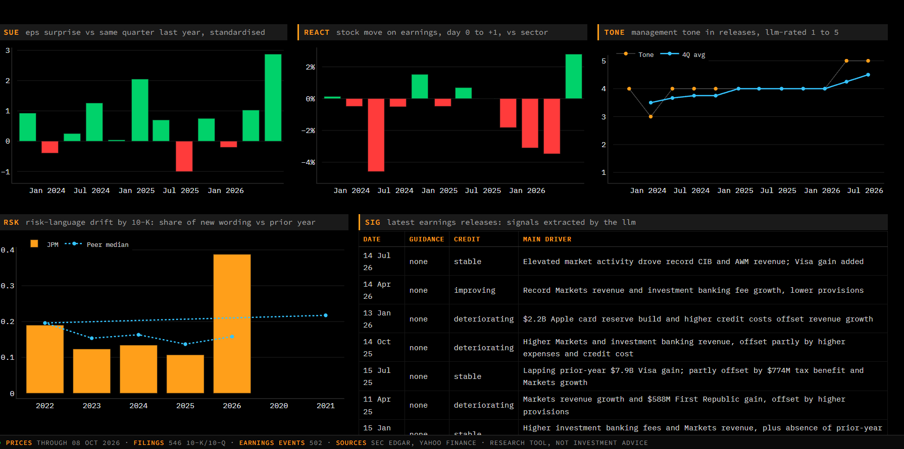

# Filings Terminal: SEC filings analytics for 21 financial companies

An end-to-end data science project on SEC EDGAR filings (10-K, 10-Q, 8-K) of 21 banks, brokers and advisory firms. It asks three questions and answers them with data:

1. **Do earnings surprises move stocks?** (event study)
2. **Does what companies *say* add anything beyond the numbers?** (text and LLM signals)
3. **Can an agent answer questions about filings with citations you can check?** (RAG + evaluation)

Everything is wrapped in a Bloomberg-style Streamlit dashboard.

<!-- Add screenshots to docs/ and keep these lines -->



## Results

| Question | Finding |
|---|---|
| EPS surprise vs stock reaction | Moves stocks, modestly: best vs worst surprise tercile differs by about +0.9 pts (peer- and season-adjusted) |
| Does tone add anything? | No. Word-list tone and LLM-rated tone add nothing detectable beyond EPS surprise |
| "Volatility signal" in filings | Looked significant (p = 0.001), vanished after comparing each filing only with peers from the same quarter. It was a common time effect |
| LLM extraction accuracy | 98.3% agreement with actual EPS direction from XBRL |
| Retrieval (hit@5) | 94% hybrid with metadata filters (keyword-only 96%; filters lift unfiltered 40-60% to 87-96%) |
| Q&A agent | 93.3% correct vs 10% for the same model with no documents (30 questions, LLM judge); 97.4% of claims supported by the cited passage |

## Architecture

```
SEC EDGAR -> edgar_ingest.py -> parse_sections.py -> build_features.py
                 |                                   (length, tone, TF-IDF drift)
                 +-> XBRL facts -> SUE (sue_control.py)
yfinance prices -> fetch_prices.py -> event_study.py / earnings_event_study.py / robustness.py
8-K earnings releases -> llm_extract.py (Claude Haiku) -> llm_event_study.py
filings -> build_index.py (paragraph chunks, bge-small embeddings + BM25)
        -> search.py (hybrid, reciprocal rank fusion, filters)
        -> agent.py (Claude tool-use: search_filings, what_changed, list_filings, citation checks)
        -> eval_retrieval.py / eval_agent.py
app.py  (Streamlit dashboard: F1 Overview, F2 Market Map, F3 Research, F4 Ask)
```

Key design choices:
- **Risk-language drift** = TF-IDF distance between a company's Risk Factors and its prior-year filing, with company names and numbers stripped so renames don't create fake jumps.
- **Abnormal return** = stock return minus XLF over day 0 to +1, then demeaned by quarter.
- **Citations are validated**: every `[C123]` in an answer must point to a passage the agent actually retrieved.

## Run it

```powershell
python -m venv .venv; .venv\Scripts\activate
pip install -r requirements.txt

# in order (each step writes to data/)
python edgar_ingest.py
python parse_sections.py
python build_features.py
python fetch_prices.py
python fetch_earnings.py
python earnings_event_study.py
python sue_control.py
python llm_extract.py        # needs ANTHROPIC_API_KEY
python llm_event_study.py
python build_index.py        # slow on CPU, 2025+ filings only

$env:ANTHROPIC_API_KEY = "your-key"   # set in the terminal only, never in files
python -m streamlit run app.py
```
Only the F4 Ask tab needs an API key (each question costs a few cents). Set your own SEC `User-Agent` (name + email) in `edgar_ingest.py`.

## Limitations

- Eval questions were written by an LLM from the passages, which favors keyword matching and is easier than real user questions.
- Small samples: about 500 earnings events, 30 graded agent questions. Differences of a few points are within noise.
- SUE is a seasonal random-walk surprise, not analyst-consensus surprise.
- Only 2025+ filings are searchable; flattened HTML tables can attach a number to the wrong period.
- Research tool, not investment advice.

## Resume bullets

- Built an SEC EDGAR pipeline over 21 financial firms (10-K/10-Q/8-K): section parsing, TF-IDF risk-language drift, XBRL-based earnings surprise, and an event study vs the XLF sector benchmark.
- Showed that EPS surprise moves stocks modestly while LLM and word-list tone add nothing beyond it, and caught a spurious volatility signal (p = 0.001) that disappeared after quarter-demeaning.
- Extracted structured signals from 500+ earnings releases with Claude (98.3% agreement with XBRL EPS direction).
- Built a cited RAG agent (hybrid BM25 + embeddings, metadata filters, tool-use, citation validation): 94% hit@5 and 93.3% judged correct vs 10% without documents.
- Shipped a Bloomberg-style Streamlit/Plotly dashboard for market, risk-drift and Q&A views.
